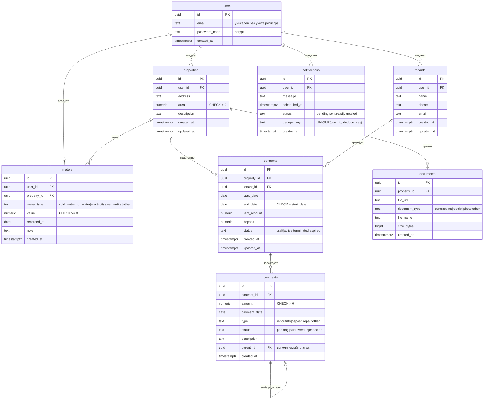

# Архитектура Rental Assistant

Документ фиксирует этап 1 (анализ и проектирование): модель данных, границы модулей, принятые
решения и риски. Актуально на момент сдачи MVP.

## 1. Стиль: modular monolith

Один процесс `cmd/api` собирает независимые бизнес-модули. Модуль знает только свои таблицы;
связи между модулями идут через узкие интерфейсы (`payments.Service` вызывает `contracts.Service`,
`notifications.Service` — `payments` и `contracts`), а не через чужие репозитории. Это даёт
возможность позже вынести модуль в отдельный сервис, не переписывая обработчики.

Типичный модуль:

```
internal/payments/
├── handler.go     # HTTP: разбор запроса, вызов сервиса, ответ
├── service.go     # бизнес-правила и валидация
├── repository.go  # SQL, ограниченный владельцем данных
└── model.go       # структуры запросов/ответов и типы-константы
```

`internal/api/router.go` — единственное место, где известны все маршруты; `cmd/api/main.go` —
единственное место сборки зависимостей (ручной DI без фреймворка).

## 2. ER-диаграмма



Ключевые индексы: `users(lower(email))` уникальный, `properties(user_id, created_at DESC)`,
`contracts(status, end_date)`, `payments(contract_id, payment_date DESC)`,
`payments(status, payment_date)`, `UNIQUE(payments.parent_id) WHERE parent_id IS NOT NULL`,
`meters(property_id, meter_type, recorded_at DESC)`, `documents(property_id, created_at DESC)`,
`notifications(user_id, scheduled_at)`.

Инварианты на уровне БД:

- `payments` и `meters` защищены триггерами `payments_append_only` / `meters_append_only`:
  `UPDATE`/`DELETE` бросают исключение;
- `updated_at` у `properties`, `tenants`, `contracts` обновляется триггером, приложение его не пишет;
- частичный уникальный индекс допускает единственное исполнение на планируемый платёж;
- `notifications.dedupe_key` не даёт создать одно напоминание дважды.

## 3. Изоляция данных

Правило: **владелец всегда берётся из JWT (`sub`), а не из тела или query.**

- `properties`, `tenants`, `notifications`, `meters` — прямое условие `user_id = $1`;
- `contracts`, `payments`, `documents`, отчёты — через `JOIN properties p ON ... WHERE p.user_id = $1`
  (и `t.user_id = $1` для арендатора);
- `INSERT` связей (договор, платёж, документ) идёт через `INSERT ... SELECT ... WHERE owner = $1`,
  поэтому привязка к чужой квартире/договору просто не создаёт строку;
- чтение чужой сущности → `404` (не `403`), чтобы не подтверждать её существование.

Проверено сквозным тестом: второй пользователь не видит объекты первого, получает `404` на
`GET /api/properties/{id}`, не может удалить чужую квартиру и скачать чужой документ.

## 4. Журналы и «просрочка»

История платежей и показаний не перезаписывается — ни в API (нет `PUT`/`DELETE` для платежей
и счётчиков), ни в БД (триггеры). Фиксация оплаты (`POST /api/payments/{id}/settle`) вставляет
новую строку со ссылкой `parent_id`; уникальный индекс гарантирует, что повторная фиксация
вернёт `409`, а не создаст второй факт оплаты.

В списках платежей исходный план, у которого есть исполнение, скрывается — пользователь видит
факт оплаты, а не двойную сумму. При этом сам план остаётся в базе как аудит-след.

`overdue` — вычисляемый статус (`pending AND payment_date < CURRENT_DATE`), в БД не пишется:
значение всегда согласовано с датой, фоновая джоба не нужна.

## 5. Файлы

`pkg/storage.Store` — интерфейс (`Save`, `Open`, `Delete`, `Exists`); реализация `LocalStore`
кладёт файлы в `FILES_DIR` с именами-UUID и не доверяет присланному имени файла (защита от
path traversal). Скачивание идёт через `GET /api/documents/{id}/file` с проверкой владельца,
а не по прямой статической ссылке. Для перехода на S3/MinIO достаточно второй реализации
интерфейса — схема БД (`file_url`) не меняется.

## 6. Аутентификация и ошибки

- bcrypt (cost 10) для паролей, `password_hash` никогда не уходит в JSON;
- JWT HS256, `sub` + `exp` + `iat`, `JWT_TTL` (по умолчанию 168h);
- пароль пользователя хранится только в виде хеша, токен — в `localStorage` фронтенда;
- единый формат ошибки `{"error": "..."}`; `pkg/apperr` отображает тип ошибки в
  `422` (валидация), `401` (нет/плохой токен), `403` (нет прав), `404`, `409` (конфликт),
  `500` (внутренняя, без деталей клиенту).

## 7. Архитектурные риски и как они закрыты

| Риск | Что сделано в MVP | Что осталось |
|------|-------------------|--------------|
| Утечка данных между пользователями | фильтр по владельцу в каждом запросе, сквозной тест изоляции | аудит-лог доступа, RLS в PostgreSQL как второй барьер |
| Перезапись истории платежей | нет методов update/delete, триггеры в БД, append-only фиксация оплаты | — |
| Двойная фиксация оплаты | частичный `UNIQUE (parent_id)` + `409` | идемпотентный ключ из клиента |
| Файлы вне хранилища/потеря файлов | локальный диск + интерфейс под S3 | S3/MinIO, presigned URL, антивирус-скан |
| Напоминания «вручную» | генерация на сервере с дедупликацией | воркер по расписанию, e-mail/Telegram, очередь |
| Секрет JWT в окружении | валидация длины, `production` требует ≥ 32 символов | ротация ключей, refresh-токены, отзыв сессий |
| Рост числа запросов дашборда | один агрегирующий запрос `GET /api/reports/summary` | кэш на 30–60 с, материализованные представления |
| Локальная разработка без Docker | инструкция и `.env.example`, миграции при старте | — |

## 8. Решения, которые сознательно упрощены

- нет отдельного слоя DTO ↔ domain (модели модуля одновременно API-контракт);
- нет OpenAPI-файла — контракт описан в [api.md](api.md);
- нет soft-delete: удаление квартиры/арендатора каскадно чистит связанные документы и счётчики,
  но договоры и платежи защищены `ON DELETE RESTRICT` (удаление невозможно, пока есть история);
- напоминания не отправляются наружу: MVP показывает их в интерфейсе и по API.
